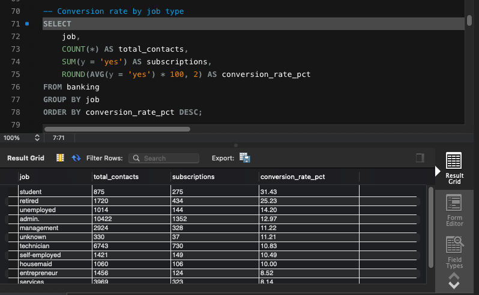
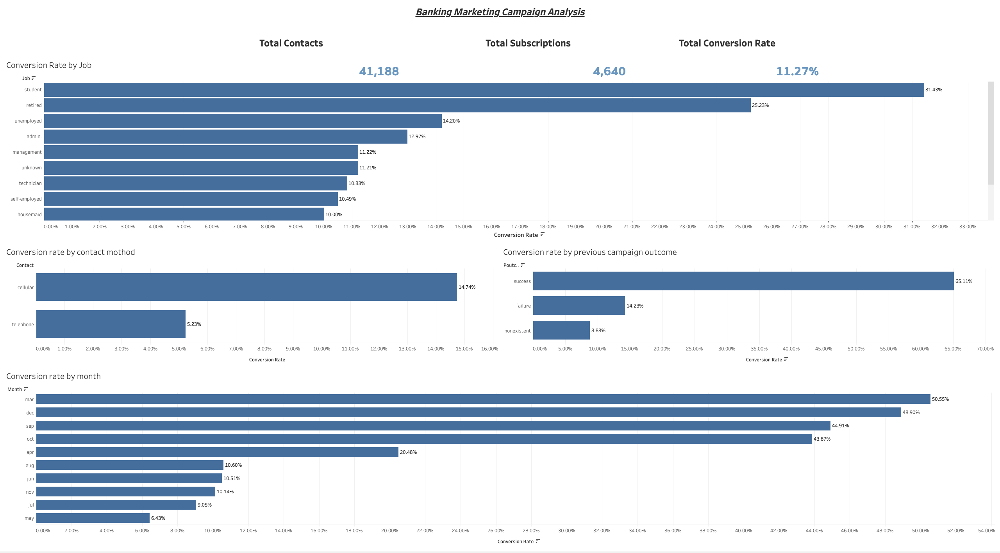

# Bank Marketing Campaign Analysis

## Project Overview

This project analyzes 41,188 bank marketing campaign records to identify patterns in customer subscriptions and campaign performance. Using MySQL and Tableau Public, I explored conversion rates across customer segments, contact methods, and campaign characteristics to identify audiences with higher response rates and opportunities to improve marketing effectiveness.

## Business Questions

- Which customer job categories have the highest conversion rates?
- How do conversion rates differ by contact method?
- How does the outcome of a previous campaign relate to customer response?
- How does conversion vary across campaign months?

## Tools Used

- **MySQL:** Data quality checks, exploratory data analysis, aggregations, and conversion-rate calculations.
- **Tableau Public:** KPI development and interactive dashboard visualization.

## Key Findings

- **Overall conversion rate:** 11.27%, with 4,640 subscriptions from 41,188 campaign contacts.
- **Job category:** Students had a 31.43% conversion rate, while retired customers had a 25.23% conversion rate.
- **Contact method:** Cellular contacts converted at 14.74%, compared with 5.23% for telephone contacts.
- **Previous campaign outcome:** Customers with a previously successful campaign outcome had a 65.11% conversion rate, compared with 14.23% for previous failures and 8.83% for records with no previous outcome.

These findings highlight differences in customer response across segments and campaign characteristics. The results show associations and do not establish that any factor directly caused higher conversion.

## SQL Analysis Example

This analysis calculates total contacts, subscriptions, and conversion rates by customer job category to identify audience segments with higher response rates.

## Tableau Dashboard

Explore the interactive dashboard to compare conversion rates across customer segments and campaign characteristics.

**[View the interactive Bank Marketing Campaign Analysis dashboard on Tableau Public](https://public.tableau.com/app/profile/oscar.canales/viz/BankingMArketingCampaignAnalysis/BankMarketingCampaignAnalysis?publish=yes)**

## Dataset

This project uses the [UCI Bank Marketing Dataset](https://archive.ics.uci.edu/dataset/222/bank+marketing), which contains customer demographic information, campaign contact details, and subscription outcomes from a bank's direct marketing campaigns.

The analysis uses 41,188 records from the `bank-additional-full.csv` dataset.

**Target variable:** `y`, indicating whether a customer subscribed (`yes` or `no`) to the bank's term-deposit product.

## Repository Contents

- `bank_marketing_analysis.sql` — SQL queries for data quality checks, exploratory analysis, and campaign performance comparisons.
- `sql-conversion-by-job.png` — Screenshot of the SQL query and results.
- `bank-marketing-dashboard.png` — Screenshot of the Tableau dashboard.

## Future Improvements

- Explore additional customer segments and interactions between campaign characteristics.
- Compare conversion rates alongside sample sizes to better assess the reliability of segment-level findings.
- Develop data-driven recommendations for customer targeting and campaign optimization.
